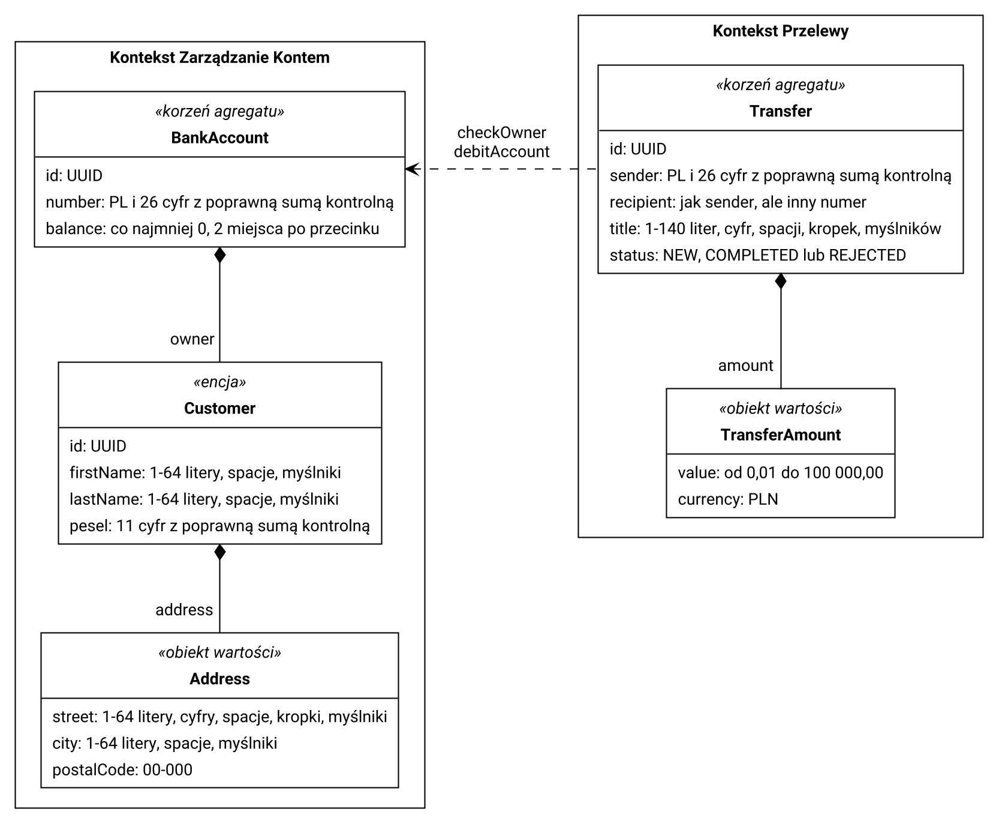

# Zadanie 1 - Domain Driven Design

Model pokazuje fragment aplikacji bankowej, w którym klient zleca przelew ze swojego konta. Są w nim dwa konteksty: Zarządzanie Kontem i Przelewy. Agregatami są BankAccount i Transfer. Customer jest encją w agregacie BankAccount, a Address i TransferAmount to obiekty wartości.

## Model

## Założenia

- Numer konta to PL i 26 cyfr, a suma kontrolna musi się zgadzać.
- Saldo konta nie może być ujemne.
- Imię i nazwisko mają maksymalnie 64 znaki i składają się tylko z liter, spacji i myślników.
- PESEL musi mieć 11 cyfr i poprawną sumę kontrolną.
- Ulica i miasto mają maksymalnie 64 znaki, a kod pocztowy jest w formacie 00-000.
- Numer konta odbiorcy też musi być poprawny i nie może być taki sam jak numer nadawcy.
- Tytuł przelewu może mieć maksymalnie 140 znaków.
- Kwota przelewu może wynosić od 0,01 do 100 000 zł.
- Zakładam, że klient ma tylko jedno konto.
- Przed przelewem checkOwner sprawdza, czy konto nadawcy należy do zalogowanego klienta.
- Potem debitAccount zmniejsza saldo nadawcy, a jeśli brakuje pieniędzy, przelew dostaje status REJECTED.
